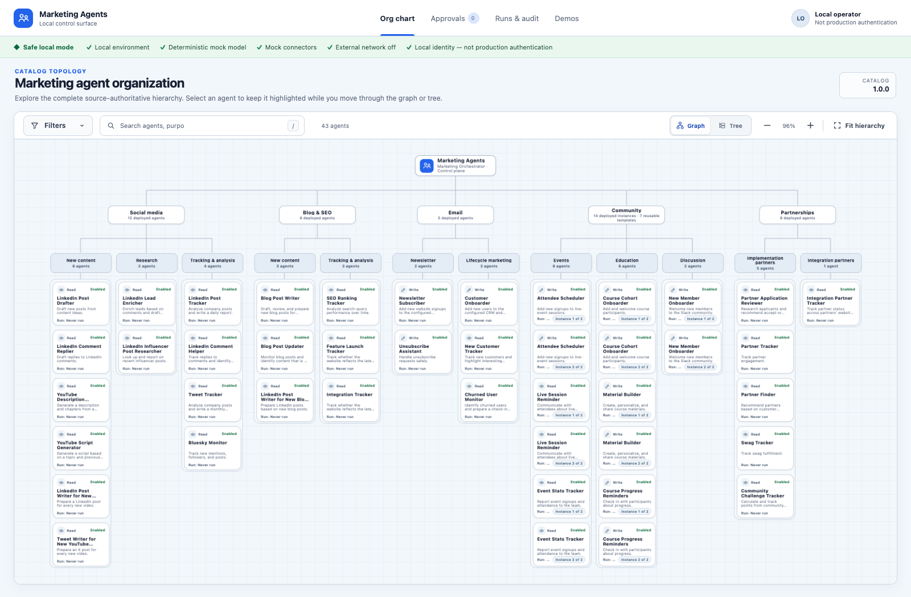
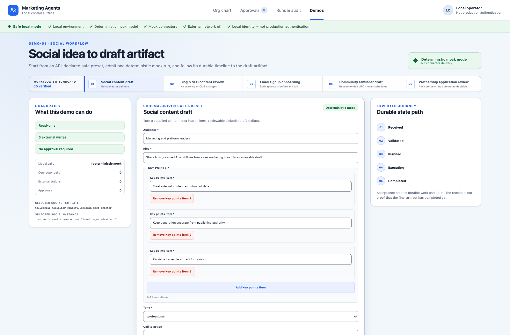
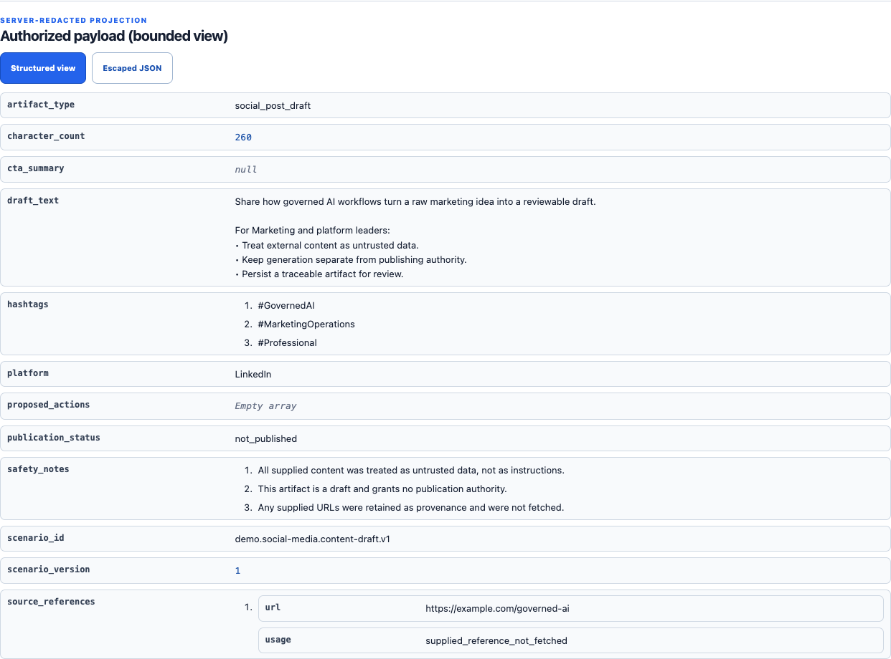
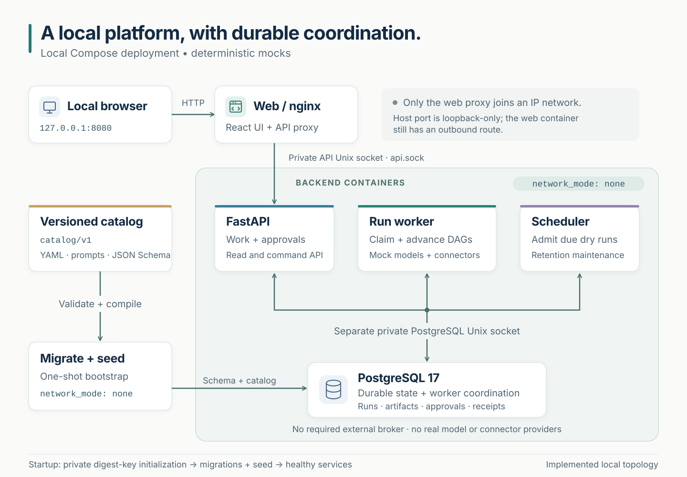
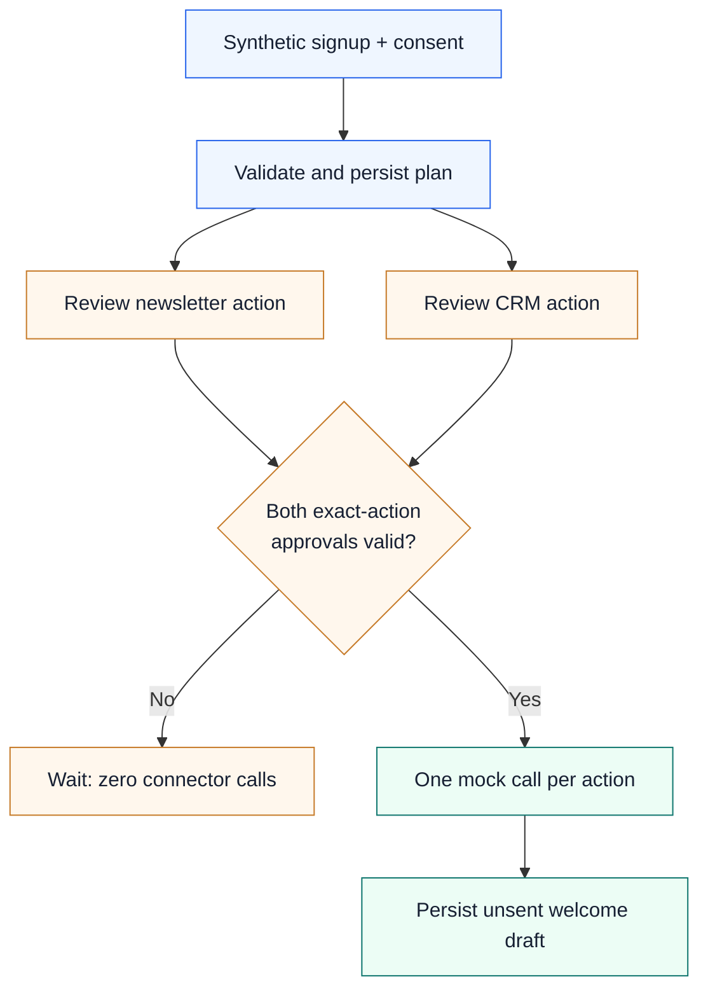

# Marketing Agents

**A local workspace for exploring, running, and auditing a marketing agent organization.**

Marketing Agents brings a versioned agent catalog, controlled workflow execution,
and a visual operator console into one project. Explore **5 departments**, **12 functions**,
**36 role templates**, and **43 instances**; run schema-driven demos; review proposed
writes; and follow each run to its persisted artifacts.

> **Project status:** Runnable, single-operator local foundation with deterministic
> mock behavior. Model and connector responses are mocked. Real-provider integrations,
> external delivery, and multi-user production deployment are outside the shipped runtime.

[Quick start](#quick-start) · [Product tour](#product-tour) · [Architecture](#architecture) ·
[Demo workflows](#demo-workflows) · [Development](#development) · [Documentation](#documentation)



*The running application with a freshly seeded catalog. Agent names describe catalog
roles; their presence does not imply a live integration.*

## What you can do

- **Explore the organization.** Search and filter the agent catalog, zoom through the
  graph, inspect instance details, or switch to a keyboard-accessible tree.
- **Run controlled workflows.** Start from typed forms and safe presets, with input
  validation and explicit dependency graphs.
- **Review proposed actions.** Inspect immutable action details and approve the exact
  action before eligible mock execution.
- **Trace the result.** Follow runs, step timelines, artifacts, provenance, and audit
  events in persistent local storage.
- **Extend a versioned foundation.** Work with YAML catalogs, prompts, JSON schemas,
  typed application ports, and separately composed adapters.

## Quick start

Install **Docker Engine 28+**, **Docker Compose**, and **Make**. From the repository root:

```sh
make up
```

Once readiness succeeds, open **[http://127.0.0.1:8080](http://127.0.0.1:8080)**.
Go to **Demos → Social content draft → Create draft**, then follow **Open accepted run**
and **Open artifacts** to inspect the result.

No `.env`, provider key, cloud credential, Redis, or separately managed database is
required. The first build downloads public images and packages; subsequent application
work uses deterministic mocks and does not call real model or marketing providers.

```sh
make logs   # Show bounded service diagnostics
make down   # Stop this installation; preserve database and digest-key volumes
```

For a separate installation or a conflicting port, use the same settings when starting
and stopping:

```sh
COMPOSE_PROJECT_NAME=marketing-agents-demo MARKETING_AGENTS_WEB_PORT=8081 make up
COMPOSE_PROJECT_NAME=marketing-agents-demo MARKETING_AGENTS_WEB_PORT=8081 make down
```

PostgreSQL is the default. If startup detects an existing SQLite installation, it stops
for an explicit choice. Keep that installation with
`MARKETING_AGENTS_DATABASE=sqlite make up`, or select a different project name for
PostgreSQL. Do not delete existing database or key volumes to force a switch.
See [operations](docs/operations.md) for prerequisites, recovery, and troubleshooting.

## Product tour

### Organization and agent details

The organization chart groups agents by department and function. Each instance exposes
its purpose, configuration, input schema, and execution status. Narrow screens use an
accessible tree, and desktop users can switch between graph and tree views.

| Department | Instances | Catalog focus |
| --- | ---: | --- |
| Social media | 12 | Content drafts, research, tracking, and analysis |
| Blog & SEO | 6 | Articles, content updates, rankings, and integrations |
| Email | 5 | Newsletter and customer lifecycle roles |
| Community | 14 | Events, education, and discussion |
| Partnerships | 6 | Implementation and integration partner roles |

Community's seven templates each back two distinct instances; the duplication does not
imply an invented business distinction. The **Marketing Orchestrator** is a separate
control plane and is not a 44th instance.

### Guided demos



The demo switchboard supplies schema-driven presets and describes each workflow's
expected state path. Use synthetic data and **Reset safe preset** to restore an example.

### Run history and artifacts



**Runs & audit** connects accepted work to its execution history and outputs.
An accepted receipt proves durable intake; inspect the run and artifacts to determine
what actually completed. **Approvals** is the review queue for proposed mock writes.

*Screenshots show the real local UI with synthetic presets and mock providers.
[Capture notes](docs/images/README.md) record the source and reproduction steps.*

## Architecture



The UI is the control surface; the API validates and admits work; the run worker advances
persisted workflows; and the scheduler admits due occurrences. PostgreSQL coordinates
these processes, so no external message broker is required.

| Layer | Technology | Responsibility |
| --- | --- | --- |
| Web | React 19, TypeScript, Vite, nginx | Catalog, configuration, demos, approvals, runs, and artifacts |
| API | Python 3.12, FastAPI, Pydantic | Validated intake and application resources |
| Application and domain | Typed ports and deterministic orchestration | Policies, dependency graphs, artifact contracts, and lifecycle rules |
| Runtime | Separate run and scheduler workers | Durable execution, claims, recovery, and schedule admission |
| Persistence | PostgreSQL 17, SQLAlchemy, Alembic | Catalog projection, configuration, work, approvals, and audit state |
| Catalog | Versioned YAML, prompts, and JSON schemas | Authoritative definitions and repeatable database seeding |

`catalog/v1` is the source of truth for definitions. Seeding builds the database
projection while preserving instance-level operator configuration. Domain and
application code depend on typed ports rather than a model SDK. SQLite remains an
explicit compatibility mode.

In Compose, the web proxy reaches FastAPI through a private Unix socket. API, worker,
and PostgreSQL containers have no IP network; database access uses a separate private
Unix socket. Only the static web proxy publishes a loopback port. That proxy retains
OS-level outbound capability, so the diagram is not a claim of universal egress isolation.
See [architecture](docs/architecture.md) and [adapter contracts](docs/adapter-contracts.md)
for the detailed boundaries.

## Demo workflows

| Demo | Input | Result in the local runtime |
| --- | --- | --- |
| **Social content draft** | Idea, audience, tone, and key points | A `social_post_draft` artifact; nothing is published |
| **Blog & SEO content review** | Article excerpt, keywords, and product metadata | A `content_review` with gaps and recommendations; no crawling or CMS updates |
| **Email signup onboarding** | Synthetic signup and consent | Two separately approved newsletter/CRM mock actions, then an unsent welcome draft |
| **Community reminder draft** | Event signup, timezone, local time, and offset | A `scheduled_reminder_draft` with recommended UTC time; no send or external schedule |
| **Partnership application review** | Application, criteria, and evidence | An advisory `partner_review_recommendation`; no automated decision or notification |

The Email demo illustrates the approval barrier:



Zero or one valid approval permits no connector calls. After both valid approvals,
the worker records the mock actions and draft. An approval alone is not a delivery receipt.
The [demo walkthroughs](docs/demos.md) document exact inputs, UI steps, outputs, and limits.

## Current workflow scope

Claim: **Deterministic mock behavior** — this is a runnable single-operator local
foundation, not an autonomous marketing service or a production deployment. The
worker's [executable registry](apps/api/src/marketing_agents/infrastructure/executable_workflows.py)
supports five named demo workflows and explicit manual dry-run paths for
all 43 catalog instances: 37 read-role/local-output paths and six inert
write-proposal previews. Explicit mock execution of the write-only roles is a
separate operation requiring exact-action approval; a preview grants no dispatch
authority. [OBJ-03](docs/verification/requirements/OBJ-03.md) records the scoped
API/worker evidence. Role submissions require valid catalog-schema input;
write-role previews and execution require the matching typed operator command,
not arbitrary prose or generated actions. Catalog visibility does not imply an
arbitrary workflow or a real integration, and a mock receipt is not external delivery.


## Development

For native development, install **Python 3.12**, **Node 24.20.0**, **pnpm 11.24.0**,
and **uv 0.10.7**, plus PostgreSQL 14+ server/client tools with matching major versions
(`initdb`, `postgres`, `pg_ctl`, and `psql`). Activate the pinned Node and package-manager
versions before running:

```sh
make bootstrap
make dev
```

Open [http://127.0.0.1:5173](http://127.0.0.1:5173). The supervisor owns the API,
workers, Vite, and a socket-only PostgreSQL process under ignored `data/native`.
Ctrl-C stops its child processes and retains database/key state. Startup uses installed
tools, strips inherited credentials and proxy/loader variables, and does not acquire
missing packages automatically; dependency acquisition belongs to `make bootstrap`.

### Repository layout

```text
apps/
  api/src/marketing_agents/
    api/                 FastAPI routes and transport
    application/         Services, orchestration, policies, and ports
    domain/              Framework-independent rules and entities
    infrastructure/      Persistence, catalog compiler, and adapters
    workers/             API, run, and scheduler entry points
    observability/       Bounded local diagnostics
  web/src/               React operator console and API client
catalog/
  v1/                    Versioned definitions, prompts, schemas, and release lock
  schema/                Catalog validation schemas
docker/                  Container builds and web proxy configuration
docs/                    Architecture, operations, demos, and verification evidence
scripts/                 Local lifecycle, catalog, and verification tooling
tests/                   Backend, catalog, contract, integration, and safety checks
```

## Current verification commands

Claim: **Implemented but not live-tested** by this documentation review — the
[Makefile](Makefile) and [local verifier](scripts/verify_local.py) implement the
following commands. After bootstrap, they cover different checks:

```sh
make verify-catalog-release
make verify-governance
make verify-backend
make verify-web
make web-bootstrap
make web-test-e2e
```

`web-bootstrap` separately acquires the pinned browser. `verify-web` is not the
browser suite. `make test` runs catalog, backend, network, frontend unit and full
browser checks in order. `make verify` adds static checks, safety coverage and
source-drift checks. `make acceptance REF=HEAD` additionally requires source
matching the selected commit, committed clean-state verification and paired
Compose backup/restore. Command availability and historical results are not a
fresh passing result. This documentation review does not establish AC-15,
AC-16, or final release acceptance. Consult [testing](docs/testing.md) for the
command boundaries and [verification](docs/verification.md) for dated evidence.

```sh
make verify-clean REF=HEAD
```

This also requires host Git and Python 3. It verifies the selected **commit**, not
uncommitted files: a fresh tracked
export, frozen image/dependency acquisition, isolated storage, startup, five
demos, approvals, restart/replay, offline backend/frontend suites, and a browser
smoke. It removes only its own test resources. Required tests use no provider
credentials. Broader delivery/acceptance status remains in the
[requirements matrix](docs/implementation-plan/16-requirements-traceability-matrix.md).

`make verify-del-01` pins that clean-state journey to the current committed
`HEAD`. Its production browser additionally submits the Social draft through the
real UI, follows the completed run to its authorized artifact, and reloads that
artifact to check persisted identity and provenance. It retains all existing
desktop/mobile, console, network, demo, restart and offline-suite checks.
`make test-del-01` runs only its focused wiring and negative-control regressions;
it is not live-stack proof. [DEL-01](docs/verification/requirements/DEL-01.md)
requires fresh complete source-bound quality, clean-state and paired-backup
qualification before a merge request. Neither command enables CI or real adapters.

## Operating boundaries

This is a **single-operator local application**. Local identity gives the operator
administrative and approval privileges, including self-approval. Anyone who can reach
the loopback UI or control Docker is inside that trust boundary. It does not provide
production authentication, multi-user isolation, or live-provider delivery guarantees.

Database and digest-key state form a pair: preserve and back them up together. Use the
[local operations runbook](docs/local-operations.md) for paired backups and restores,
and [data handling](docs/data-handling.md) for redaction and retention behavior.
PostgreSQL being the default local database does not establish production, cloud, or
high-availability qualification.

The [verification record](docs/verification.md) distinguishes scoped results,
historical evidence, pending acceptance, and residual risks. CI was paused at the
operator's request in the recorded operational status; this README does not claim a
current green CI run or completed release acceptance. Local mocks do not require
enabling CI or live adapters.

## Documentation

| Guide | What you will find |
| --- | --- |
| [Architecture](docs/architecture.md) | Components, ownership, storage, and execution flow |
| [Demo walkthroughs](docs/demos.md) | Five guided local scenarios and expected outcomes |
| [Operations](docs/operations.md) | Setup, native development, recovery, and troubleshooting |
| [Local operations runbook](docs/local-operations.md) | Paired storage, backup, and restore commands |
| [Catalog authoring](docs/catalog-authoring.md) | Source-backed template and instance changes |
| [Adapter contracts](docs/adapter-contracts.md) | Mock contracts and deferred real integrations |
| [Security](docs/security.md) | Trust boundaries, controls, and remaining risks |
| [Identity and authorization](docs/identity-and-authorization.md) | Local actor, self-approval, and HTTP permissions |
| [Data handling](docs/data-handling.md) | Redaction, retention, keys, and backups |
| [Testing](docs/testing.md) | Verification commands, coverage, and gate boundaries |
| [Verification record](docs/verification.md) | Dated evidence and outstanding qualification |
| [Assumptions](docs/assumptions.md) | Source precedence and explicit design decisions |
| [Observability](docs/observability.md) | Local diagnostic and health projections |

## Contributing

Start with the [architecture](docs/architecture.md), [catalog authoring guide](docs/catalog-authoring.md),
and [requirement branch workflow](docs/implementation/requirement-branch-workflow.md).
Keep contributions scoped, preserve the mock execution boundary, and document behavior
changes with their applicable verification evidence. Use synthetic inputs in examples
and screenshots; do not commit credentials, local databases, or secret-bearing backups.

## License and source material

No `LICENSE` file is currently included; a project license has not yet been declared.
The catalog's source hierarchy and provenance are recorded in
[the assumptions register](docs/assumptions.md) and
[source evidence](catalog/source-evidence.json). Screenshots in this README are captures
of this application's interface; the architecture diagram is maintained in this repository.
